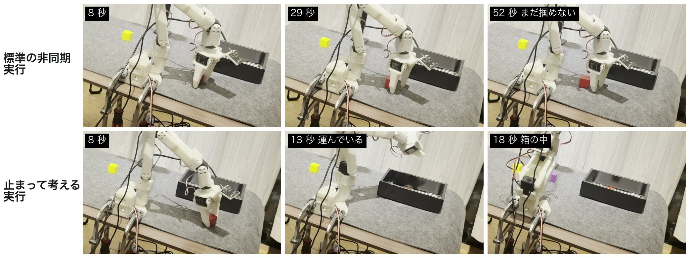

# VLA はなぜ掴めないのか ― 実機 SO-101 で原因を突き止め、言葉で頼める片付けロボットにした記録

Physical AI 講座 2026 応用編1 最終課題

- 動画(YouTube): (公開後に追記)
- 説明資料: [`説明資料_PAI最終課題_142291.pdf`](説明資料_PAI最終課題_142291.pdf)

自分で録画した手本で π0.5 をファインチューンし、机の上の 3 色のキューブを箱へ片付けさせた。学習は順調に見えたのに、
実機ではキューブのすぐ上まで行って掴めない。この「なぜ」を、記録したデータと対照実験で一つずつ切り分けた。



| 見つけたこと | 根拠 | 結果 |
|---|---|---|
| 推論の遅延(約 1 秒)の間に、外れやすい予測の後半を実行していた(最有力の原因) | 予測と人の操作の比較: 先頭 0〜5 ステップの誤差 3.3、35〜50 ステップは 13.1 | 止まって考える実行(K = 15 の同期実行)で 33% → **80%**(同じモデル・同じ 15 配置・同じ晩) |
| 学習データに無い状況(箱にキューブが入った状態)では動かない | 学習データ 144 本の開始状態を調べたら 0 本。記録した場面の再生で「動こうとする量」1.6 | その状況の手本 45 本を足すと 120.8(動くようになった) |
| 人が手伝った操作を学習に戻すと伸びた(示唆) | 同じだけ学習を足して比べた: 手助けあり(R2・R3)12/15、手助けなしの対照 10/15 | 67% → **80%**(学習を延ばしただけでは 67% のまま。ただし差は 15 試行中 2 回で言い切れない) |

最後に、言葉の指示(Claude)・成否の判定・やり直し・失敗の説明・人への引き継ぎをつないで、「片付けて」と頼めるロボットにした。

## 動画の見どころ(2:54)

| 時刻 | 場面 |
|---|---|
| 0:03 | **同じモデル・同じ置き場所で、標準の非同期実行(60 秒たっても掴めない)と止まって考える実行(16 秒で箱へ)を並べて再生(1 倍速)** |
| 0:26 | なぜ取り組むか / しくみの全体図 |
| 0:38 | 原因: 予測の先ほど外れ、遅延の間に外れやすい後半を実行していた |
| 0:50 | 同じモデル・同じ晩・同じ 15 配置で 33% → 80% |
| 1:00 | データの穴(箱に入った状態の手本が 0 本 → 足すと動く、53% → 67%) |
| 1:10 | 「紫以外を片付けて」→ 赤と黄だけを箱へ(1 倍速)。「片付けて」で 3 色(1:21〜1:39 は 4 倍速) |
| 1:39 | 「緑のを入れて」→ 机を見て断る |
| 1:51 | 「赤だけ入れて」→ 掴めない理由を自分で説明してやり直し → 3 回で人を呼ぶ → リーダーアームで引き取り(2:17〜2:29 は 4 倍速) |
| 2:34 | **引き取った操作を学習に戻すと 67% → 80%。学習を延ばしただけの対照は 67% のまま** |

## 処理の流れ

```
「紫以外を片付けて」 ─▶ 段取り(Claude が俯瞰画像を見て色の順番を決める。無い色・できない指示は断る)
                                           │ 1 色ずつ
                                           ▼
        π0.5(自前データでファインチューン。H200 で推論、Mac でアームを動かす。止まって考える実行)
                                           │
        俯瞰カメラで判定(箱の中で 1 秒止まったら成功) ── 成功 ─▶ ホームへ戻って次の色
                                           │ 失敗
        何が起きたかを Claude が画像で説明して読み上げ ─▶ ホームへ戻ってやり直し(最大 3 回)
                                           │ 3 回とも失敗
        声で人を呼ぶ ─▶ 人がリーダーアームで引き取る(その動きは学習データとして保存)
```

## サンプル(ベースライン)との関係

| 講座のサンプル | この作品で加えたこと |
|---|---|
| SO-101 入門(テレオペ・録画・学習) | 3 照明 × 3 色の録画手順、1 本ずつの監査ツール、置き場所の偏りの分析、π0.5 のファインチューン(H200)、置き場所を映像に示して毎回同じ配置で比べる評価ツール |
| 自然言語でロボット操作 | 言葉 → 色の列(構造化出力で検証)→ 学習済みの指示文、の 2 段構え。画像で卓上の状態を確かめ、無い色や箱の中の色は除く |
| VLM でロボットを動かす | 成否の判定(キューブは色検出、それ以外は Claude)、失敗の説明、やり直しと人への引き継ぎ |
| (サンプルに無い) | 遅延の原因の切り分けと止まって考える実行、データの穴の発見、人の手助けを学習に戻す効果の対照実験 |

## 主な結果(すべて実機。15 配置 = 5 か所 × 3 色を固定の順で 1 回ずつ。95% 信頼区間つき)

| 比較 | 結果 |
|---|---|
| 実行の仕方(同じモデル・同じ晩) | 非同期 5/15 = 33% [15–58%] → 止まって考える 12/15 = 80% [55–93%](配置ごとに 9 対 2、正確な McNemar 検定 p = 0.065) |
| 学び直し | R0 8/15 → R1 10/15 → R2 12/15 → R3 12/15。対照(R1 のまま学習だけ延長) 10/15 |

**訂正**: 対照の評価(10/28)は当初 14/15 と記録したが、失敗しかけた 4 回で作者が指でキューブを掴みやすくしていたため、成功に数えない(正しくは 10/15)。ほかの評価では手を出していない。
| 通し動作「片付けて」(8 回 = 24 色) | 人の手を借りずに 13/24(R1)→ 15/24(R2)。残りは人を呼んで引き取り、最終的に 24/24 |
| 失敗の説明(評価の失敗 8 回) | 型の一致 4/8(作者が録画で分類した型と比較) |

経緯と試行ごとの結果は [`docs/evaluation.md`](docs/evaluation.md) と [`outputs/eval/results.csv`](outputs/eval/results.csv)(成否は作者が見てキーで記録)。

**切り分けきれていないこと**: 止まって考える実行は、前半を捨てる以外にも、新旧の予測を混ぜない・止まってから撮るという点で非同期と違う。どれが効いたかまでは分けていない。

## ファイル構成

| 段階 | ファイル | 役割 |
|---|---|---|
| 準備 | `scripts/00_*`〜`05_*` | USB・モーター設定・校正・カメラの確認、箱とカメラの位置合わせ(`05f_align_camera.sh`) |
| 録画 | `scripts/06_record.sh`、`scripts/21_record_guided.py`、`scripts/20_round1_guide.py` | 手本の録画(案内付き録画は、置き場所の丸と音声で次にやることを示す) |
| データの点検 | `scripts/06d_audit_dataset.py`、`scripts/22_trim_episodes.py` | 1 本ずつの監査(箱・キューブの検出、照明、置き場所の偏り)、人の手助け区間の整形 |
| 学習 | `scripts/07b_launch_remote_train.sh`、`docs/h200-training.md` | H200 での π0.5 / SmolVLA / ACT のファインチューン |
| 推論・実行 | `scripts/remote/fast_server.py`、`scripts/remote/fast_client.py`、`scripts/12_language_remote.sh` | H200 で推論、Mac で実行(JPEG 転送、止まって考える実行 `SYNC_K`) |
| 通し動作 | `scripts/16_orchestrator.py`、`scripts/17_orchestrate.sh`、`scripts/planner.py`、`scripts/explain.py`、`scripts/objects.py` | 段取り → 1 色ずつ実行 → 判定 → 失敗の説明 → やり直し → 人への引き継ぎ(録画して保存) |
| 評価 | `scripts/14_eval.py`、`scripts/18_eval_analysis.py`、`scripts/19_autonomy.py`、`scripts/remote/offline_gt.py`、`scripts/remote/replay_probe.py` | 同じ 15 配置での評価、試行の分析、自律化率の集計、予測と人の操作の比較、記録した場面の再生 |
| 図・動画 | `scripts/23_report_figures.py`、`scripts/27_final_video.py` | 説明資料の図、提出動画の編集(場面・字幕・倍速の表示) |

```bash
# 同じ 15 配置で評価(試行前に俯瞰映像へ置き場所の丸が出る)。SYNC_K=0 で標準の非同期実行
SYNC_K=15 TRIAL_SEC=60 EVAL_TAG=fixed .venv/bin/python scripts/14_eval.py run pi05_r2ctl 004000
# 通し動作(段取りに Claude を使うなら config.env に ANTHROPIC_API_KEY)
RUN=pi05_r2ctl CKPT=004000 scripts/17_orchestrate.sh "紫以外を片付けて"
```

## 限界と今後

- 1 条件 15 試行で信頼区間が広い。15 試行の中の 1 配置ごとの成否は揺れる。評価者は作者 1 人、1 台、1 つの机。
- 止まって考える実行は 1 色 20〜45 秒と遅い。遅延の短縮や、遅延を見込んだ予測(Real-Time Chunking など)との組み合わせが次の課題。
- 学習に無い物(例えば消しゴム)をどこまで扱えるかは確かめきれていない(1 回試しただけ)。段取り役は教わっていない物を区別し、人に持ち方を頼む。
- 人の手助けを学び直しに使う方法(区間の整え方・重み・量、HG-DAgger などの対話的な模倣学習)は今後の課題。

## 生成 AI の利用・ライセンス・クレジット

開発では Claude(Claude Code)をコードの作成、録画の分析、文書の下書きに使い、判断と実機の作業は作者が行った。
ロボットの段取り・判定・失敗の説明には Claude API を使う(`ANTHROPIC_API_KEY` が無ければキーワードのルールで動く)。
コードは MIT ライセンス([`LICENSE`](LICENSE))。π0.5 の重みは公開しない。

使わせてもらったもの:
- [LeRobot](https://github.com/huggingface/lerobot)(Apache-2.0): 録画・学習・非同期推論・SO-101 の制御
- [openpi / π0.5](https://github.com/Physical-Intelligence/openpi)(Apache-2.0)。重みは Gemma の利用規約に従う。SmolVLA・ACT は LeRobot の実装
- Claude API(Anthropic): 段取り・成否の判定(キューブ以外)・失敗の説明
- FFmpeg、OpenCV、matplotlib: 動画の編集と図
- 動画のオープニング・エンディングのジングルは講座の運営が配布したもの
